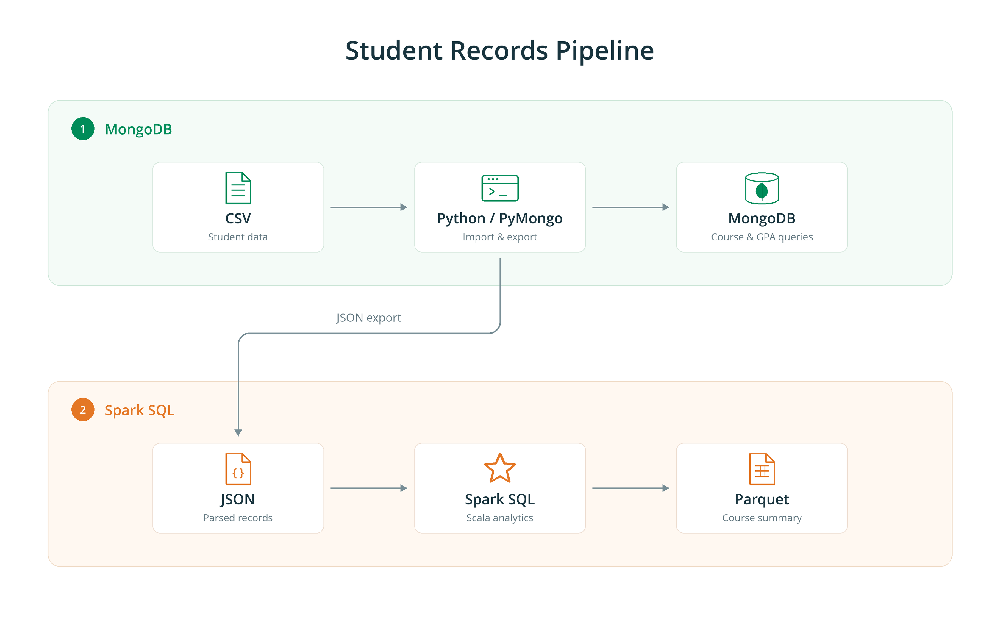

# Homework 2: Student Records with MongoDB and Spark SQL

This project imports 100 student records into MongoDB, runs interactive MongoDB queries, and analyzes the JSON export with Spark SQL in Scala.

Part 4 uses Option B from the assignment: JSON input and Parquet output.

## Package contents

| Path | Purpose |
| --- | --- |
| main.py | Parses the CSV, loads university.students, creates indexes, and exports JSON Lines. |
| queries.py | Runs the interactive course, GPA, and combined queries, and prints the course query's execution plan. |
| spark_sql.scala | Runs all nine Spark SQL queries and verifies the Parquet round trip. |
| hw2-data.csv | Original input containing 100 student records. |
| students.json | Parsed records, with one JSON document per line. |
| course_stats.parquet/ | Spark-generated per-course summary and write-success marker. |
| results/spark_sql_output.txt | Output captured from the supplied complete execution of spark_sql.scala. |
| requirements.txt | Python dependency for the MongoDB stage. |

## Requirements

- Python 3 with PyMongo.
- A local MongoDB server listening at mongodb://127.0.0.1:27017.
- Apache Spark with its Scala shell. The recorded run used Spark 4.1.2, Scala 2.13.17, and Java 17.
- Run the following commands from the directory containing main.py and students.json.

The MongoDB Spark Connector is not required for Option B.

## Run Parts 1-3

Create and activate a Python environment, then install the dependency:

    python3 -m venv .venv
    source .venv/bin/activate
    python -m pip install -r requirements.txt

Start the local MongoDB server using your existing installation, then run:

    python main.py
    python queries.py

main.py resets university.students before inserting all 100 documents in a single insert_many call. It recreates the courseIds and gpa indexes on every run.

The MongoDB documents use integer IDs, UTC datetime values, integer course arrays, and floating-point GPA values. The JSON export represents dates as ISO 8601 strings; the Scala reader explicitly loads them as timestamps.

For queries.py, use these sample inputs:

| Prompt | Input |
| --- | --- |
| Course ID | 103 |
| Minimum GPA | 3.5 |
| Optional course ID | 103 |

The expected match counts are 36, 49, and 9, respectively. Press Enter at the optional course prompt to skip the combined query.

The course lookup is sorted by last name. GPA and combined lookups are sorted by GPA descending. The program rejects non-integer course inputs and GPA inputs outside the range 0.0 to 4.0.

The program prints the winning execution plan. The previously verified course-103 run used IXSCAN on courseIds_1, with isMultiKey set to true. That run examined 36 index keys and 36 documents to return 36 students.

## Run Part 4

Start Spark Shell from the project directory:

    spark-shell --master "local[*]"

At the Scala prompt, run:

    :load spark_sql.scala

The script prints each SQL statement and its output. It creates the students and enrollments temporary views, saves the per-course summary, and reads the saved data back.

Each analytical question is implemented with one spark.sql call.

## Verified results

| Check | Result |
| --- | --- |
| Student records | 100 |
| Course 103 matches | 36 |
| GPA strictly greater than 3.5 | 49 |
| Course 103 and GPA strictly greater than 3.5 | 9 |
| Student-course enrollment rows | 218 |
| Students taking one, two, and three courses | 8, 66, and 26 |
| Rows in the first three GPA ranks per course | 94 |
| Pairs with the same first and last name | 7 |
| Students above every enrolled course's average GPA | 49 |
| Saved course-summary rows | 5 |
| Parquet rows match the original summary | true |

Per-course summary, ordered by enrollment count descending:

| Course | Student count | Average GPA | Minimum GPA | Maximum GPA |
| --- | --- | --- | --- | --- |
| 101 | 48 | 3.56 | 3.1 | 3.9 |
| 105 | 47 | 3.50 | 3.1 | 3.9 |
| 104 | 44 | 3.59 | 3.1 | 3.9 |
| 102 | 43 | 3.50 | 3.1 | 3.9 |
| 103 | 36 | 3.39 | 3.1 | 3.9 |

### Ties in the ranking query

DENSE_RANK assigns the same rank to students with the same GPA. The query retains ranks 1, 2, and 3 in each course, including all ties. A course can therefore have more than three returned students. The total of 94 counts student-course rows; a student can appear in several courses.

### Students above every course average

The query computes per-course averages with DECIMAL arithmetic and keeps the averages unrounded for comparison. For each student, their GPA must be strictly greater than the largest average among their enrolled courses. This satisfies the condition for every enrolled course.

### MongoDB and Spark SQL comparison

MongoDB handles the interactive field lookups and exposes index use through explain(). Spark SQL handles array expansion, aggregation, ranking, and joins over the exported data. Both stages return 36 students for course 103 and 49 students for GPA greater than 3.5.

### Parquet verification

Spark writes a directory named course_stats.parquet. Read the complete directory with Spark:

    spark.read.parquet("course_stats.parquet").orderBy("course").show(false)

The script compares the original and reloaded summaries with exceptAll in both directions, preserving duplicate counts. The recorded execution ends with:

    Saved courses: 5
    Results match: true
    Spark SQL analysis complete.

The supplied output file records the successful complete run. The saved Parquet data and the source programs are included in this package.
